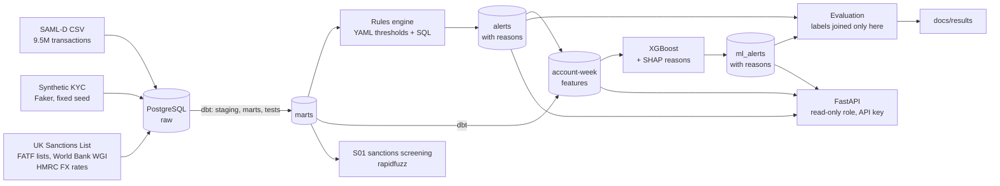
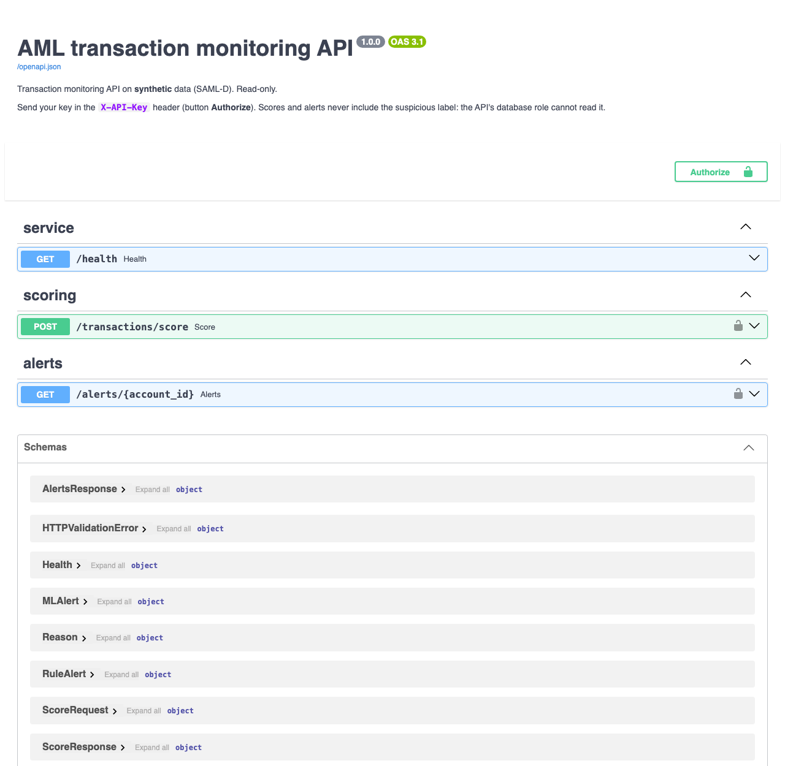

# AML Transaction Monitoring System

[](https://github.com/viveksnalegavamath-hash/aml-transaction-monitoring/actions/workflows/ci.yml)

An anti-money-laundering (AML) transaction monitoring system of the kind UK banks run, built end to end on **9.5 million synthetic, UK-focused transactions**. Typology rules raise alerts, an XGBoost model ranks every active account each week, every alert explains itself in plain English, customers are screened against the UK Sanctions List, a read-only REST API serves scores and alerts, and the results are measured honestly: thresholds and models chosen on one period, reported on a later, untouched one.

> All transactions and customers are **synthetic** (SAML-D and a Faker-generated KYC table). No real personal data is used. The sanctions, FATF and World Bank data are public official lists.

**Status: fast track complete (29 Oct 2026).** Data foundation, rules engine with tuning, sanctions screening, worked investigation case, ML layer (XGBoost with SHAP reasons, compared with the rules on the same hold-out), and a read-only FastAPI service running in Docker Compose with CI on every push. What was cut, and why, is under [Future work](#future-work).

## Results at a glance

Full data, hold-out months **1 Jun – 23 Aug 2023** (thresholds were never tuned on these months). 486,685 active accounts, of which 2,490 are suspicious: a base rate of **0.51%**.

| | Untuned baseline | **Tuned rules** |
| --- | --- | --- |
| Alerts per week | 21,843 | **5,053 (−77%)** |
| Suspicious accounts caught by any rule (account recall) | 72.9% | **58.6%** (goal ≥ 65%: missed) |
| Suspicious transactions caught by any rule | 81.9% | 65.9% |
| Weakest rule (R07) lift over random | 1.2× | **10.6×** |

**Per rule, tuned, hold-out:**

| Rule | Looks for | Alerts / week | Precision | Lift | Account recall |
| --- | --- | --- | --- | --- | --- |
| R01 Structuring | ≥ 3 cash deposits of £8,000–£9,999.99 in 7 days | 0 | – | – | 0.0% |
| R02 Many-to-one | ≥ 10 senders and ≥ £20,000 in 7 days | 355 | 3.9% | 7.6× | 6.8% |
| R03 One-to-many *(tuned)* | ≥ 10 receivers and ≥ £100,000 in 7 days | 706 | 2.1% | 4.0× | 10.5% |
| R04 Rapid pass-through | ≥ 80% of ≥ £10,000 received sent on within 48 hours | 901 | 3.0% | 5.9× | 10.4% |
| R05 High-risk jurisdiction | FATF lists (June 2026) or internal country rating high | 739 | 2.7% | 5.2× | 11.4% |
| R06 Large vs profile *(tuned)* | Payment > 10× the account's own 90-day mean and > £5,000 | 827 | 3.6% | 7.0× | 26.6% |
| R07 Behaviour change *(tuned)* | 30-day volume > 15× the previous 90-day average, ≥ £25,000 | 795 | 5.4% | 10.6× | 21.4% |
| R09 Cash intensity | > £5,000 cash and > 50% of inflows in 30 days | 730 | 3.3% | 6.5× | 16.5% |
| **Any rule** | | **5,053** | | | **58.6%** |

*Precision* = share of alerts whose account had a suspicious transaction in the 30 days before the alert. *Lift* = precision ÷ base rate (how much better than picking accounts at random). *Account recall* = share of suspicious accounts alerted. Accuracy is never reported: with 0.5% positives it means nothing.

**Reading it honestly:** tuning cut alerts by 77% on the untouched months and made every tuned rule sharper, but recall fell below the 65% goal, a goal that **was** met on the tuning months (78.5%). The miss is reported as it came out; re-tuning on the hold-out would have turned it into a second tuning set. Recovering recall at the same alert volume is the job of the ML layer. Full reports: [`docs/results/rules_evaluation.md`](docs/results/rules_evaluation.md) (tuned), [`rules_evaluation_baseline.md`](docs/results/rules_evaluation_baseline.md), tuning tables [`tuning_R03.md`](docs/results/tuning_R03.md) · [`R06`](docs/results/tuning_R06.md) · [`R07`](docs/results/tuning_R07.md).

**Rules vs ML on the same hold-out, same alert volume.** An XGBoost model scores every active account once a week, using 56 behaviour features: rolling 7/30/90-day counts, totals, new counterparties, cash and cross-border shares, and amounts against the account's own history. A second variant adds the rules' alerts as features. Both models were chosen on May 2023 and scored on the hold-out **once**, at the rules' 5,053 alerts a week:

| Hold-out (1 Jun – 23 Aug 2023) | Precision | Lift | Account recall | PR-AUC |
| --- | --- | --- | --- | --- |
| Rules only (tuned) | 3.4% | 6.7× | 58.6% | 0.007 |
| ML only | 9.7% | 18.9× | 99.8% | 0.770 |
| **Rules + ML** | **9.7%** | **19.0×** | **99.8%** | **0.771** |

- At the same volume, rules + ML catches **1,027 suspicious accounts the rules missed** and misses only 1 the rules caught.
- To match the rules' recall it needs **197 alerts a week instead of 5,053 (−96%)**.
- Every ML alert carries its top three SHAP reasons in plain English, e.g. *"4 new payees in 7 days; 3 new senders in 7 days; 7 new senders in 30 days"*.

**Read with care:** SAML-D makes this easy. 91% of laundering weeks involve a never-seen counterparty, against 12% of normal weeks, and real data would score far lower. The SAML-D "receiver is a customer" artefact was left out; it would have raised PR-AUC to 0.800. Rule hits add almost nothing on top of the behaviour features. Model documentation: [`docs/model.md`](docs/model.md); results: [`ml_evaluation.md`](docs/results/ml_evaluation.md), [`ml_validation.md`](docs/results/ml_validation.md).

**Sanctions screening (S01)**, against the UK Sanctions List of 02 Oct 2026, fuzzy matching at a threshold of 90:

| Measure | Result |
| --- | --- |
| Customers screened | 292,715 (synthetic) |
| Customers matched | 238, or **8.1 per 10,000** (individuals 6.9, businesses 15.3) |
| Labelled test set: realistic variations of real list names caught | **98.7%** of 2,883 (spelling, word order, missing middle name, formatting) |

The synthetic customers are not on any list, so every KYC match is a false match by construction. A labelled test set built from real list names is what shows that true matches are found. Details: [`docs/results/screening.md`](docs/results/screening.md).

## Worked investigation case

[`docs/case_study.md`](docs/case_study.md) follows one alerted customer through **L1 review → L2 investigation → MLRO decision → SAR** to the National Crime Agency under the UK process (POCA 2002, tipping off, DAML). It ends with a short SAR narrative covering who, what, where, when and why, all labelled as a SYNTHETIC TRAINING EXAMPLE. Checked against the ground truth afterwards, the five cash-in/money-out pairs the investigation isolated are exactly the ten transactions SAML-D labels as laundering. The customer with the most rules firing turned out to be entirely normal, which is why alerts need ranking, not counting.

## How it works



- **Data and modelling:** raw files load unchanged into PostgreSQL with an audit log. **dbt** cleans and types them, maps countries to ISO codes, joins FATF status and an internal country rating (World Bank governance indicators, split into thirds), and tests every assumption: row counts, keys, accepted values, one common amount scale. 112 dbt tests in total.
- **Rules engine:** each rule is a YAML spec (thresholds, rationale, owner, dated change log) plus a SQL file. Results are written to `marts.alerts` with a plain-English reason and the transactions behind each alert. Results stream from the database in batches, so a full run of all rules over 9.5M rows takes about 28 minutes with under 2 GB of memory.
- **Evaluation:** split by **time**, never randomly. Tuning months are Oct 2022 – May 2023; the hold-out is Jun – Aug 2023. The laundering label is joined only in evaluation code, after alerts exist, and is never used in rules or features. Every rule is scored the same way, by alerted account and alert time.
- **Tuning:** above/below-the-line testing on the tuning months only. Candidates are generated once and filtered for each option, and the tuning shortcut was checked against the slow, trusted path before use.
- **ML layer:** one row per active account-week, with features computed in dbt from exact 7/30/90-day windows that end on the scoring day. A brute-force test proves no feature uses a later transaction. Training uses weeks scored January–April 2023; May chooses the settings and stops the boosting early; the hold-out is scored once, and the code refuses to score it twice. A logistic regression baseline and XGBoost runs are tracked in MLflow. Alerts are the top accounts of each week, at a fixed capacity, each with its top three TreeSHAP reasons.
- **Sanctions screening:** normalised names (accents, titles, legal suffixes), rapidfuzz word-order and subset scoring, and date of birth and nationality used to set the review priority. These never drop a match, because a missed sanctions hit is an offence.
- **API:** FastAPI with Pydantic schemas, served from Docker Compose next to the database. It connects as a read-only database role that has no access to the label schema, so no response can contain a label. Details under [API](#api).
- **Decisions are written down:** [`LEARNING.md`](LEARNING.md) records every design decision with the alternatives considered, including the ones that did not work.

## Repository layout

```text
src/aml_transaction_monitoring/
    ingestion/    loaders, synthetic KYC generator, country risk, FX rates
    rules/        rules engine and one SQL file per rule
    screening/    S01 sanctions screening
    ml/           account-week features, models, SHAP reasons (no labels)
    evaluation/   rules report, tuning harness, ML training and evaluation
    api/          FastAPI app, read-only role setup, model export
rules/            R01–R10 and S01 YAML specs (all thresholds live here)
config/           generator, evaluation periods, tuning grids, ML and API settings
dbt/              staging, marts, features, evaluation models, seeds, tests
sql/profiling/    data profiling and leakage checks
tests/            pytest (249 tests; 175 need no database and run in CI)
docs/             project plan, results, worked case, model documentation
Dockerfile        API image; docker-compose.yml runs it next to PostgreSQL
.github/          CI workflow: ruff and tests on every push
```

## How to run

Prerequisites: Docker Desktop, [uv](https://docs.astral.sh/uv/), a Kaggle account for the data, and about 15 GB of free disk (the full database is about 12 GB).

1. Install the Python environment and the tools:

   ```bash
   uv sync
   uv tool install dbt-core==1.12.5 --with dbt-postgres==1.11.0
   uv tool install kaggle
   ```

2. Copy `.env.example` to `.env` and fill in your own values (never commit `.env`). Then start the database. It listens on 127.0.0.1 only:

   ```bash
   docker compose up -d
   ```

3. Download the data into `data/raw/` (see [`data/README.md`](data/README.md) for every source and licence). The FATF pages must be saved from a browser, because the site blocks automated downloads.

4. Load, build and run. Each command is one step:

   ```bash
   uv run python -m aml_transaction_monitoring.ingestion.load_raw
   uv run python -m aml_transaction_monitoring.ingestion.kyc_generator
   uv run python -m aml_transaction_monitoring.ingestion.wgi
   uv run python -m aml_transaction_monitoring.ingestion.country_risk
   uv run python -m aml_transaction_monitoring.ingestion.fx_rates
   cd dbt && dbt build && cd ..
   uv run python -m aml_transaction_monitoring.rules.engine
   uv run python -m aml_transaction_monitoring.evaluation.rules_report
   uv run python -m aml_transaction_monitoring.screening.screen
   uv run python -m aml_transaction_monitoring.evaluation.ml_experiment validate
   uv run python -m aml_transaction_monitoring.evaluation.ml_experiment holdout
   ```

   The ML hold-out stage runs once; it refuses to overwrite its own report. MLflow runs go to `mlruns/` and trained models to `data/ml/` (both git-ignored).

   For development, `dbt build --vars '{dev_sample: true}'` and the `--sample` flags work on a 10% account sample. Reported numbers always come from the full data.

5. Checks: `uv run pytest` and `uv run ruff check .` (CI runs the same on every push, without the database).

## API

A read-only REST API over the alerts and the ML model. Interactive Swagger docs are at **http://127.0.0.1:8000/docs** once it runs.



| Endpoint | Key needed | What it does |
| --- | --- | --- |
| `GET /health` | no | Database reachable, model loaded |
| `POST /transactions/score` | yes | Scores one account-week, given `{"account_id": "...", "week_end": "2023-08-23"}` (a Wednesday), with the served XGBoost model (rules + ML), and returns the score and its top three SHAP reasons in plain English |
| `GET /alerts/{account_id}` | yes | The account's rule alerts and ML alerts, newest first |

**Run it** (after step 4 above, once the ML validate stage has run):

1. Create the API's secrets and its read-only database role, then export the model:

   ```bash
   uv run python -m aml_transaction_monitoring.api.provision
   uv run python -m aml_transaction_monitoring.api.model_store
   ```

   `provision` adds `API_KEY` and `API_DB_PASSWORD` to `.env` without printing them. It creates the role `aml_api_reader`, which can read only the alert and feature tables, and checks that the role can neither reach the label schema nor write. `model_store` writes the model in XGBoost's JSON format and checks it scores real rows exactly like the trained one.

2. Start the database and the API (both listen on 127.0.0.1 only):

   ```bash
   docker compose up -d --build
   ```

   Without Docker: `uv run uvicorn --factory aml_transaction_monitoring.api.app:create_app --host 127.0.0.1 --port 8000 --no-access-log`

3. Open http://127.0.0.1:8000/docs, click **Authorize**, paste your `API_KEY` from `.env`, and try an endpoint. For example, `POST /transactions/score` with `{"account_id": "5826952585", "week_end": "2023-08-23"}` returns a score of 1.000 and *"4 new payees in 7 days; 7 new senders in 30 days; 3 new senders in 7 days"*.

**Controls:**
- The `X-API-Key` header is checked in constant time.
- Basic rate limiting: 60 requests a minute per client, then `429` with `Retry-After` (`config/api.yaml`).
- Pydantic rejects unknown fields, non-digit account IDs and weeks that do not end on a Wednesday.
- Errors return a short message, never a stack trace. Logs show the route template (`/alerts/{account_id}`), never an account ID.
- The container runs as a non-root user on a read-only filesystem, with all Linux capabilities dropped, and receives only the variables it needs.

## Data and licences

| Data | Source | Licence |
| --- | --- | --- |
| SAML-D transactions (synthetic) | Oztas et al., IEEE ICEBE 2023, via Kaggle | CC BY-NC-SA 4.0 |
| UK Sanctions List | FCDO, GOV.UK | Open Government Licence v3.0 |
| FATF lists, June 2026 | FATF, saved pages (only the facts are used; pages not redistributed) | © FATF/OECD |
| Worldwide Governance Indicators | World Bank | CC BY 4.0 |
| HMRC monthly exchange rates | GOV.UK Trade Tariff | Open Government Licence v3.0 |
| KYC customers | Generated by this project with Faker | Synthetic, not real people |

Raw data is never committed. The results files in `docs/` are derived from SAML-D and so fall under its non-commercial, share-alike licence.

## Security

- Credentials come only from environment variables (`.env`, git-ignored); none are hard-coded.
- The database and the API bind to `127.0.0.1` only. Containers run with `no-new-privileges`; the API container is also non-root, read-only and without Linux capabilities.
- The API reads through a separate read-only database role that cannot see the label schema. Its password is stored in PostgreSQL as a SCRAM verifier computed locally, so the plain password is never sent to the server.
- gitleaks scans every commit (pre-commit hook). Dependencies are pinned in `uv.lock`, the Docker image installs them with hash checks, CI actions are pinned to commit SHAs, and Dependabot alerts are on.
- One real incident is written up in [`LEARNING.md`](LEARNING.md): a database password was shown in a development session transcript. It was rotated the same day, and the cause and its prevention are recorded.

## Limitations

- **Synthetic data.** The KYC profile is generated independently of the transactions, so profile-based rules carry no signal here. R10 (income mismatch) is built and tested but disabled for that reason. SAML-D has no balances, branches or beneficiary names.
- **R01 never fires.** SAML-D's structuring deposits average about £5,246, below the textbook "just under £10,000" band. The band was kept rather than fitted to one synthetic generator.
- **Lists from a later date.** Country risk and the sanctions list (2026) are applied to 2023 activity.
- **Single train/test split.** One tuning period and one hold-out, with no rolling re-validation yet.
- **ML results are flattered by the data.** SAML-D's laundering almost always involves a new counterparty, a far cleaner signal than real data offers, where normal customers also pay new people and launderers reuse accounts. The method transfers; the near-perfect recall would not (see [`docs/model.md`](docs/model.md)).

## Future work

- Charts of the results in this README (planned as the Power BI replacement; the results are in tables for now).
- Cut from this version, with the reasons recorded: R08 round-tripping (SAML-D has no 3–4-account cycles), network analysis, the IBM AMLworld out-of-sample test, daily customer risk scores, AWS deployment, n8n re-screening workflow, an AI analyst assistant, a Power BI dashboard, a real-time payment hold after a SAR.

## Licence

The code is released under the [MIT Licence](LICENSE). The data is not covered by it: each dataset keeps its own licence (see [Data and licences](#data-and-licences)).

## Author

Vivek Nalegavamath — portfolio project for AML, KYC, RegTech and financial-crime data roles in the UK.
