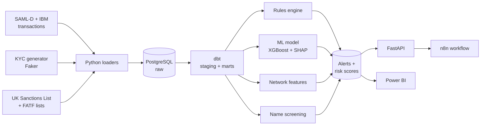
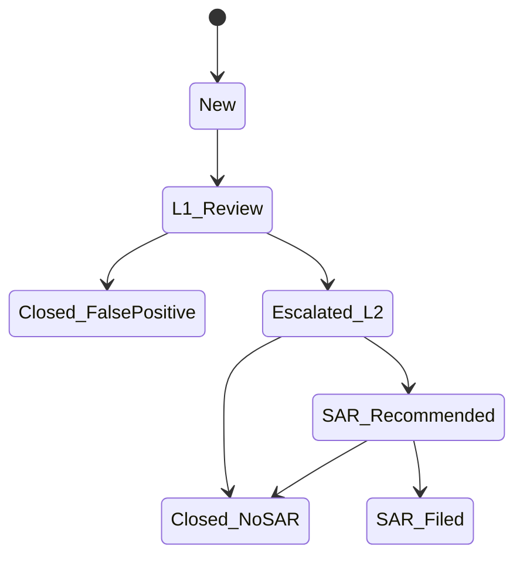

# AML Transaction Monitoring System — Project Plan

A working transaction monitoring (TM) system of the kind UK banks run to detect money laundering. It reads millions of transactions, flags suspicious activity with documented rules and an explainable ML model, scores customer risk, routes alerts through an analyst workflow, and reports on a dashboard.

**Pipeline:** transactions in → rules + ML check them → alerts → each alert explained → API, automation and dashboard.

## Deliverables

1. Public GitHub repository with clean code, tests and a strong README
2. Live REST API on AWS that scores a transaction and returns alerts
3. Power BI dashboard of alerts, risk scores and typologies
4. Model documentation written the way banks document models
5. Demo video and write-up

## Phases (~6 weeks at 15–20 hours a week)

| Phase | When | Work | Outcome |
| --- | --- | --- | --- |
| 0. Setup | Days 1–2 | Tools, repo, PostgreSQL in Docker | A repo that runs |
| 1. Data foundation | Week 1 | Load SAML-D, profile, build KYC, country-risk and sanctions tables | Clean, tested AML database |
| 2. Rules engine | Week 2 | 10 detection rules, alerts, per-rule evaluation | CV-ready v1 |
| 3. Risk + ML + network | Weeks 3–4 | Customer risk rating, XGBoost, graph features, SHAP | Hybrid rules + ML system |
| 4. API, n8n, Docker, AWS | Week 5 | FastAPI, n8n workflow, Docker Compose, AWS deployment | Live demo link |
| 5. Dashboard + showcase | Week 6 | Power BI, model documentation, README, demo video | Finished portfolio piece |

Each phase ends with something that works.

## Data

Real bank transaction data is never public: privacy and legal barriers, incomplete labels (much laundering is never caught), and no single bank sees the full money trail ([Altman et al., 2023](https://arxiv.org/pdf/2306.16424)). Synthetic data built to mimic banks is the professional standard for this work.

| Data | What it is | Size | Use |
| --- | --- | --- | --- |
| [SAML-D](https://github.com/BOztasUK/Anti_Money_Laundering_Transaction_Data_SAML-D) | Synthetic UK-focused transfers, designed with 8 AML experts | ~9.5M transactions, ~0.1% suspicious, 28 typologies (11 normal, 17 suspicious) | Core data |
| [IBM AMLworld](https://github.com/IBM/AML-Data) HI-Small | Synthetic multi-bank world, 8 laundering patterns | 5M transactions, 515K accounts, 1 in 981 illicit | Unseen test set |
| [UK Sanctions List](https://www.gov.uk/government/publications/the-uk-sanctions-list) (FCDO) | Official UK designations; the only UK source since 28 Jan 2026 | Updated several times a week | Name screening, daily re-screening |
| [FATF lists, June 2026](https://www.fatf-gafi.org/en/countries/black-and-grey-lists.html) | 3 call-for-action + 22 increased-monitoring jurisdictions | 25 countries | Country-risk table |
| [OpenSanctions](https://www.opensanctions.org/licensing/) | Sanctions + PEP data, CC BY-NC 4.0 | Global | PEP screening |
| Synthetic KYC table | Generated with Faker, fixed seed | One row per account | Occupation, declared income, nationality, PEP flag, onboarding date |

SAML-D columns: time, date, sender, receiver, amount, payment type, sender bank location, receiver bank location, payment currency, receiver currency, is-suspicious flag, typology. Suspicious typologies include structuring, smurfing, layered fan-in/fan-out, cycles, bipartite, scatter-gather, over-invoicing, deposit-send and behaviour change.

### Data flow (Phase 1)

1. **Download** into `data/raw/` (git-ignored).
2. **Load raw** into schema `raw` exactly as downloaded; never edit raw data.
3. **Profile** with SQL: counts, nulls, amounts, payment types, cross-border share, suspicious rate by typology.
4. **Clean** into `staging`: types, one timestamp, GBP amount, ISO country codes.
5. **Enrich** into `marts`: join KYC, country risk and sanctions flags.
6. **Test** with dbt: no null IDs, amounts > 0, every account has a customer, row counts reconcile.

### Data rules

- The suspicious label is the answer key: used only to evaluate, never inside rules or features.
- Split by time, never randomly.
- Develop on a 10% sample; run the full set in PostgreSQL.
- Record lineage in `data/README.md`: source, download date, licence.

## Architecture

Everything from the loaders to the API and n8n runs in Docker; in Phase 4 the same containers move to AWS ECS Fargate. The pipeline runs as a nightly batch (like most bank TM systems), plus one real-time scoring endpoint.

### Database tables

| Table | One row per | Key columns |
| --- | --- | --- |
| `raw.saml_d` | Transaction as downloaded | All 12 original columns |
| `staging.stg_transactions` | Clean transaction | txn_id, timestamp, sender, receiver, amount_gbp, payment_type, sender_country, receiver_country |
| `marts.dim_customer` | Account holder (synthetic KYC) | account_id, occupation, declared_income, nationality, pep_flag, onboarding_date, kyc_risk_rating |
| `marts.dim_country` | Country | iso_code, fatf_status, country_risk_score |
| `ref.sanctions` | Designated person or entity | name, aliases, regime, date_of_birth, nationality |
| `marts.fct_transactions` | Enriched transaction | clean columns + customer and country risk |
| `marts.alerts` | Alert | alert_id, rule_id, account_id, score, reasons, created_at, status |
| `marts.cases` | Investigation case | case_id, alert_ids, decision, sar_recommended, closed_at |
| `marts.customer_risk` | Customer per day | account_id, date, risk_score, risk_band, top_drivers |

### API endpoints

| Endpoint | Purpose |
| --- | --- |
| `POST /transactions/score` | Score one payment in real time: rules hit, ML score, reasons |
| `GET /alerts` | List alerts by status, rule or risk band |
| `PATCH /alerts/{id}` | Record an analyst decision in the audit trail |
| `GET /customers/{id}/risk` | Customer risk score and drivers |
| `POST /screening/name` | Sanctions/PEP check with match scores |
| `GET /health` | Liveness check |

## Detection framework

Rules are tailored to typologies, understood by staff, calibrated and backed by a documented rationale, as the FCA expects ([FCG 3.2](https://handbook.fca.org.uk/handbook/fcg3/fcg3s2)). MLR 2017 reg. 28(11) requires scrutiny of transactions to ensure they are "consistent with the relevant person's knowledge of the customer, the customer's business and risk profile" ([legislation.gov.uk](https://www.legislation.gov.uk/uksi/2017/692/regulation/28)).

| ID | Rule | Logic (starting values, to be tuned) | Window | SAML-D typology |
| --- | --- | --- | --- | --- |
| R01 | Structuring | 3+ cash deposits each £8,000–£9,999 | 7 days | Structuring |
| R02 | Many-to-one | 10+ distinct senders into one account, total ≥ £20,000 | 7 days | Smurfing, Fan-In, Layered Fan-In |
| R03 | One-to-many | 10+ distinct receivers from one account | 7 days | Fan-Out, Layered Fan-Out |
| R04 | Rapid pass-through | 80%+ of inflows sent out, inflows ≥ £10,000 | 48 hours | Deposit-Send, Scatter-Gather, Gather-Scatter |
| R05 | High-risk jurisdiction | Any payment to a FATF call-for-action country; ≥ £5,000 to a grey-list country | Per payment | Cross-border |
| R06 | Large vs profile | Amount > 3× customer's 90-day average and > £10,000 | Per payment | Single Large Transaction |
| R07 | Behaviour change | 30-day volume > 5× prior 90-day monthly average, or dormant 90+ days then active | 30 days | Behaviour Change 1 and 2 |
| R08 | Round-tripping | Funds return to origin within 4 hops | 30 days | Cycle, Bipartite, Stacked Bipartite |
| R09 | Cash intensity | Cash > 50% of monthly inflow and > £5,000 | 30 days | Cash deposit/withdrawal abuse |
| R10 | Income mismatch | 30-day inflows > 2× declared monthly income | 30 days | Over-Invoicing |
| S01 | Sanctions / PEP match | Fuzzy match ≥ 90 against UK Sanctions List or PEP list | Onboarding + list update | Screening queue |

Each rule has a YAML spec in `rules/`: ID, name, typology, plain-English logic, parameters, window, regulatory rationale, expected weekly alert volume, owner, date last tuned.

**Tuning:** baseline precision/recall per rule → above-the-line test (raise threshold, count true hits lost) → below-the-line test (lower threshold, sample extra alerts) → choose and record before/after numbers.

**Customer risk (0–100, daily):** 0.30 × Customer + 0.25 × Geography + 0.20 × Product/Channel + 0.25 × Behaviour. Bands: Low < 40, Medium 40–69, High ≥ 70.

**Alert priority:** 0.5 × Rule severity + 0.3 × ML score + 0.2 × Customer risk. Weights are starting points to justify and test.

## Machine learning and network analytics

The model sits beside the rules: it ranks alerts, cuts false positives and catches patterns rules miss.

| Feature group | Features (per account, rolling 7/30/90 days) |
| --- | --- |
| Volume | count and total in/out, average and max amount |
| Counterparties | distinct senders/receivers, new counterparties |
| Behaviour | amount z-score vs own 90-day average, in/out ratio, hours between payments, round-amount share |
| Channel + geography | cash share, cross-border share, share to FATF-listed countries |
| Customer (KYC) | account age, occupation risk, PEP flag, inflow vs declared income |
| Network | in/out degree, PageRank, cycle membership, community size, share of alerted counterparties |

Steps: logistic regression baseline → XGBoost/LightGBM with class weights → time-based train/validate/test → score IBM HI-Small without retraining → MLflow tracking.

Measure with PR-AUC, precision, recall, and the business metric: at fixed analyst capacity (e.g. top 500 alerts a week), extra true cases caught and false positives removed versus rules alone. Never accuracy.

SHAP gives each alert its top three reasons in plain English, stored in `alerts.reasons`.

Network (NetworkX, one graph per 30 days): cycles within 4 hops (feeds R08), fan-in/out hubs, Louvain communities; one suspicious network exported with pyvis for the README.

## Alerts, cases, automation and governance

Every status change is written to an audit table (who, when, why).

**UK SAR process modelled:** the MLRO decides; SARs go to the UKFIU at the National Crime Agency via the SAR Portal ([NCA](https://www.nationalcrimeagency.gov.uk/what-we-do/crime-threats/money-laundering-and-illicit-finance/suspicious-activity-reports)); a DAML request runs on a 7-working-day notice period. The project includes one mock SAR narrative for a synthetic case, labelled as a synthetic training example.

**AI analyst assistant:** an endpoint sends a closed alert's structured data to the Claude API and returns a 5-line L1 summary and a first-draft SAR narrative (who, what, where, when, why). Controls: synthetic data only, analyst always reviews, every prompt and output logged, 20 drafts scored against a checklist.

**n8n workflow (daily 07:00, self-hosted):**

1. Download the UK Sanctions List CSV
2. Diff against yesterday; keep new or changed designations
3. Re-screen every customer via `POST /screening/name`
4. Summarise each new match with the AI assistant
5. Pause for a human to confirm or dismiss
6. Open a case for confirmed matches; log every step

**Model governance** mirrors the PRA's SS1/23 principles ([Bank of England](https://www.bankofengland.co.uk/prudential-regulation/publication/2023/may/model-risk-management-principles-for-banks-ss)) in `docs/model_documentation.md`: purpose and scope; data and lineage; methodology; performance; limitations and risks; monitoring (monthly PSI, retrain if PSI > 0.25); change log of every threshold change.

## Roadmap checklists

### Phase 0 — Setup
- [ ] Database running and healthy, bound to 127.0.0.1
- [ ] DBeaver connected
- [ ] Datasets downloaded into `data/raw/`
- [ ] Smoke test: Python ↔ PostgreSQL
- [ ] gitleaks pre-commit hook; GitHub 2FA, secret scanning, push protection
- [ ] First commit and push

**Done when:** `docker compose up -d` starts a healthy database and the repo is on GitHub with no secrets or data.

### Phase 1 — Data foundation
- [ ] Python loader: CSV → `raw` schema with PostgreSQL `COPY`
- [ ] 10 profiling queries; findings in `data/README.md`
- [ ] KYC table with Faker (fixed seed)
- [ ] dbt staging and marts models, with tests
- [ ] 10% development sample

**Done when:** `dbt build` passes every test.

### Phase 2 — Rules engine
- [ ] YAML spec for R01–R10
- [ ] Rules engine: reads YAML, runs SQL, writes `marts.alerts`
- [ ] pytest: each rule fires and does not fire on tiny hand-made data
- [ ] Evaluation report: alerts, precision, recall per rule; rule × typology matrix
- [ ] Tune three rules with above/below-the-line testing
- [ ] S01 sanctions screening with rapidfuzz
- [ ] README results table

**Done when:** one command produces alerts and the evaluation report.

### Phase 3 — Risk, ML and network
- [ ] Daily customer risk scores and bands
- [ ] Feature tables in dbt
- [ ] NetworkX graph, cycle detection, graph features
- [ ] Logistic regression baseline, then XGBoost; MLflow tracking
- [ ] Top three SHAP reasons on each alert
- [ ] Score IBM HI-Small without retraining
- [ ] Rules-only vs rules + ML at the same alert volume

**Done when:** the hybrid's extra true cases and removed false positives are stated with numbers.

### Phase 4 — API, n8n, Docker and AWS
- [ ] FastAPI endpoints with Pydantic schemas, API-key auth, rate limiting, tests
- [ ] Dockerfile; database + API + n8n in Docker Compose
- [ ] GitHub Actions: ruff + pytest on every push
- [ ] AWS: budget alert, image to ECR, ECS Fargate, secrets in Secrets Manager
- [ ] AI analyst assistant endpoint
- [ ] n8n daily re-screening workflow with human approval; export to `automation/`

**Done when:** a public URL serves Swagger docs and `POST /transactions/score` works.

### Phase 5 — Dashboard and showcase
- [ ] Power BI: executive overview, rule performance, customer risk, typology + geography
- [ ] Model documentation and mock SAR narrative
- [ ] README: architecture, results, screenshots, how to run
- [ ] 3-minute demo video

**Done when:** a recruiter understands the project from the README in 60 seconds.

## Sources

- [SAML-D dataset](https://github.com/BOztasUK/Anti_Money_Laundering_Transaction_Data_SAML-D) and [paper](https://eprints.bournemouth.ac.uk/40982/1/Full_IEEE_Dataset_Conference_Paper%20(4).pdf)
- [IBM AML-Data](https://github.com/IBM/AML-Data) and [Altman et al., NeurIPS 2023](https://arxiv.org/pdf/2306.16424)
- [UK Sanctions List](https://www.gov.uk/government/publications/the-uk-sanctions-list) and [single-list change, 28 Jan 2026](https://www.gov.uk/guidance/moving-to-a-single-list-for-uk-sanctions-designations-28-january-2026)
- [FATF call for action, June 2026](https://www.fatf-gafi.org/content/fatf-gafi/en/publications/High-risk-and-other-monitored-jurisdictions/call-for-action-june-2026.html) and [increased monitoring, June 2026](https://www.fatf-gafi.org/content/fatf-gafi/en/publications/High-risk-and-other-monitored-jurisdictions/increased-monitoring-june-2026.html)
- [FCA FCG 3.2](https://handbook.fca.org.uk/handbook/fcg3/fcg3s2) · [MLR 2017 reg. 28](https://www.legislation.gov.uk/uksi/2017/692/regulation/28) · [NCA SARs](https://www.nationalcrimeagency.gov.uk/what-we-do/crime-threats/money-laundering-and-illicit-finance/suspicious-activity-reports) · [PRA SS1/23](https://www.bankofengland.co.uk/prudential-regulation/publication/2023/may/model-risk-management-principles-for-banks-ss)
- [OpenSanctions licensing](https://www.opensanctions.org/licensing/) · [AWS App Runner availability change](https://docs.aws.amazon.com/apprunner/latest/dg/apprunner-availability-change.html)
